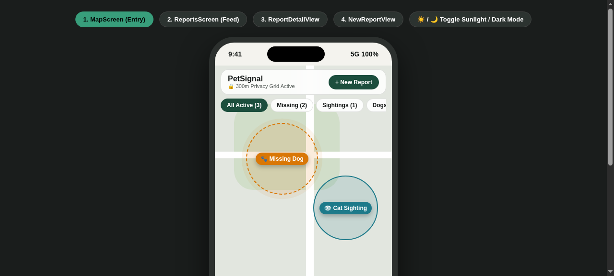
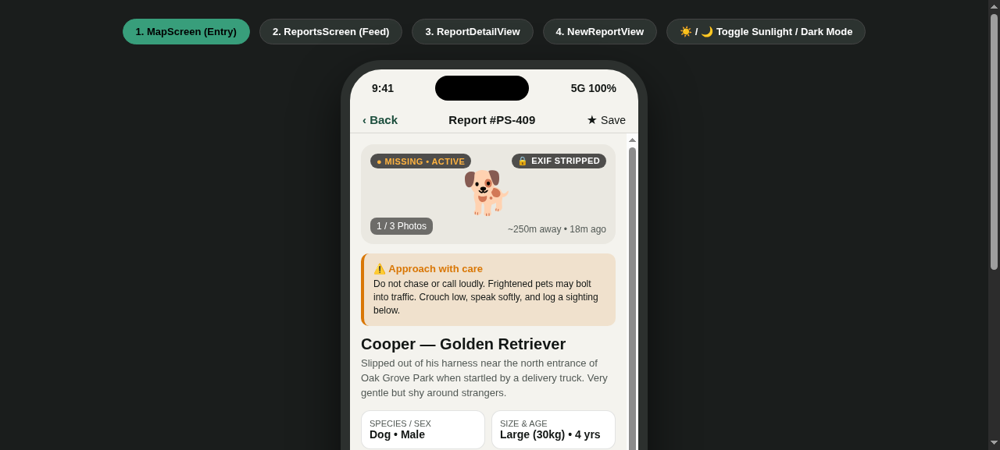
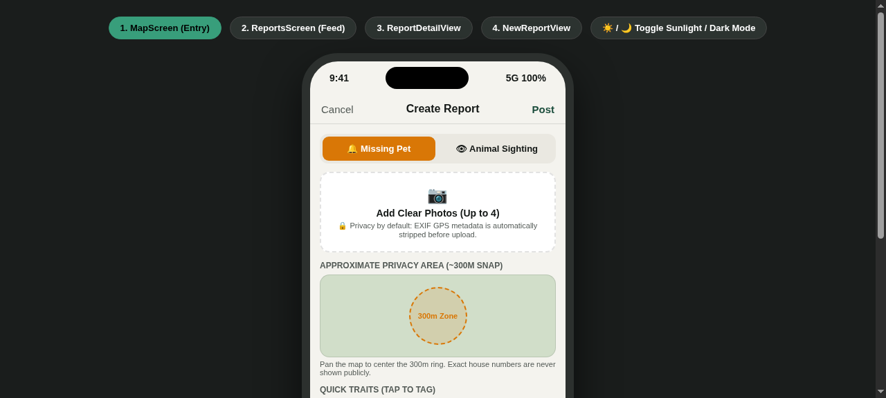
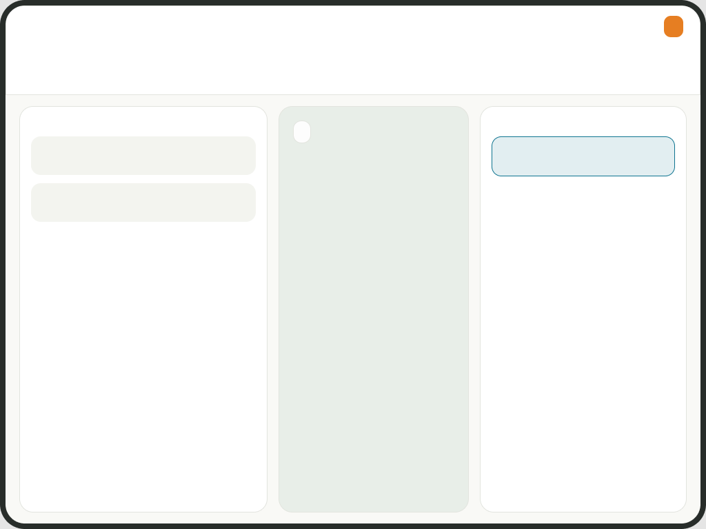

# PetSignal

> **A privacy-first, community-driven iOS platform for reporting missing animals, sharing sightings, and reuniting pets with their families through explainable trait-matching.**

[](#technical-specifications)
[](#architecture)
[](https://github.com/gust330/PetSignal/actions/workflows/ios-tests.yml)
[](LICENSE)

---

## The Problem & Our Approach

Losing a pet is distressing and time-critical. Traditional social media posts and community posters scatter information across disparate channels, lack privacy protection around exact home coordinates, and leave pet owners manually sifting through unstructured sighting comments.

**PetSignal** replaces this with an intuitive, map-first, outdoor-optimized SwiftUI application engineered for rapid action and community trust:

```
┌────────────────────────────────────────────────────────────────────────┐
│                        PETSIGNAL ARCHITECTURE                          │
├────────────────────────────────┬───────────────────────────────────────┤
│  [🗺️] Map-First Spatial Feed   │  [🔍] Trait-Matching Engine           │
│  · Interactive MapKit cluster  │  · Multi-variable scoring algorithm   │
│  · 300m privacy circle grid    │  · Explainable match factor chips     │
│  · Outdoor high-contrast tokens│  · Distance & recency weighting       │
├────────────────────────────────┴───────────────────────────────────────┤
│  [⚡] 5-Step Guided Reporting  │  [📱] Native iOS 17 Craft             │
│  · Interactive area crosshair  │  · XcodeGen declarative project specs │
│  · Metadata-stripped photos    │  · Dynamic Type & Haptic feedback     │
│  · Quick trait badge tagging   │  · 18/18 macOS CI automated tests     │
└────────────────────────────────────────────────────────────────────────┘
```

---

## Core Features

### 1. Spatial Map & Privacy Grid
- **300m Privacy Obfuscation**: Public coordinates are mapped to a 300-metre privacy circle rather than displaying precise residential addresses.
- **Outdoor Sunlight-Contrast Tokens**: High-contrast semantic color palette tailored for direct daylight usability during neighborhood search efforts.
- **Dual Presentation**: Seamless transition between interactive MapKit pins and an 84x84 compact report feed card system.

### 2. Explainable Trait Matching (`PetSignal/Features/ReportMatcher.swift`)
- **Deterministic Match Scoring**: Evaluates candidate matches between lost alerts and sightings across:
  - Species and breed correlation
  - Geographic proximity decay function
  - Temporal recency window
  - Distinctive visual traits (collar color, fur patterns, microchip status)
- **Transparent Match Chips**: Displays plain-English explanation badges (*e.g., "Within 1.2km", "Same breed (Golden Retriever)", "Reported within 2h"*).

### 3. Five-Step Report Creation Flow
1. **Report Type**: Distinguish *Missing Pet* from *Sighting / Found Pet*.
2. **Animal Information**: Species, breed, name, age bracket, and identifiable markings.
3. **Location Pinning**: Spatial crosshair with visual 300m privacy perimeter confirmation.
4. **Media Handling**: In-app camera/library image selection with EXIF privacy stripping.
5. **Contact & Safety Guidelines**: Emergency coordinator contacts and reunification protocol.

---

## Visual Previews

| Sentinel Map | Community Signals | Report Detail | Mission Control (Tablet) |
|:---:|:---:|:---:|:---:|
|  |  |  |  |

> 🎨 **Figma Design System & Mockups:** Available in Figma at [`https://www.figma.com/design/l8CFKPboMZSzNmsBmDSUBK`](https://www.figma.com/design/l8CFKPboMZSzNmsBmDSUBK).  
> 🌐 **Interactive Preview:** Test all mobile screens and responsive tablet mode in [`petsignal-preview.html`](petsignal-preview.html).

---

## Technical Specifications

- **Platform Target**: iOS 17.0+ (iPhone & iPad)
- **UI Framework**: Native SwiftUI with modern Observation framework (`@Observable`)
- **Mapping**: MapKit (`MapReader`, `MapCameraPosition`, `MapContentBuilder`)
- **Project Generation**: [XcodeGen](https://github.com/yonaskolb/XcodeGen) (`project.yml`)
- **CI / CD Pipeline**: GitHub Actions running on `macos-15` runners with `xcodebuild test`
- **Maturity & State**: Local in-memory sample dataset and offline store prototype; persistent backend services remain a future milestone.

---

## Project Structure

```
PetSignal/
├── project.yml                 # Declarative XcodeGen configuration
├── .github/workflows/          # Automated CI test pipelines (ios-tests.yml)
├── PetSignal/
│   ├── App/                    # App entrypoint and navigation coordinator
│   ├── Features/               # Core domain flows (Map, Feed, ReportCreation, Matcher)
│   ├── Models/                 # Domain entities (PetReport, Sighting, TraitMatch)
│   ├── Services/               # Storage, geolocation, and notification abstractions
│   └── Resources/              # Color assets, icons, and DesignSystem tokens
├── PetSignalTests/             # Unit tests (Matching algorithm, privacy grid, store)
├── previews/                   # Rendered screenshots and interface assets
└── petsignal-preview.html      # Standalone interactive prototype preview
```

---

## Getting Started

### Prerequisites

- macOS 14+ with **Xcode 15+** installed
- **XcodeGen** CLI installed via Homebrew:

```bash
brew install xcodegen
```

### Generating the Project & Running Tests

1. **Clone the repository:**
   ```bash
   git clone https://github.com/gust330/PetSignal.git
   cd PetSignal
   ```

2. **Generate the Xcode project file:**
   ```bash
   xcodegen generate
   ```

3. **Open and Run:**
   ```bash
   open PetSignal.xcodeproj
   ```
   Select an iOS Simulator target (iPhone 15 Pro / iOS 17+) and press `Cmd + R` to build and run.

4. **Execute Native Test Suite:**
   ```bash
   # From command line
   xcodebuild test -project PetSignal.xcodeproj -scheme PetSignal -destination 'platform=iOS Simulator,name=iPhone 15'
   
   # Or in Xcode: Cmd + U
   ```

---

## Quality Assurance & Verification

The test suite covers:
- **`ReportMatcherTests`**: Verification of weight decays, candidate scoring thresholds, and negative match filtering.
- **`ReportStoreTests`**: In-memory lifecycle mutations, bookmarking, and resolved state transitions.
- **Privacy Grid Math**: Verification that raw coordinates are snapped to $\approx 300\text{m}$ circular bounding sectors.

---

## Author & License

Engineered by **Gustavo Teixeira** ([@gust330](https://github.com/gust330)).  
Released under the [MIT License](LICENSE).
